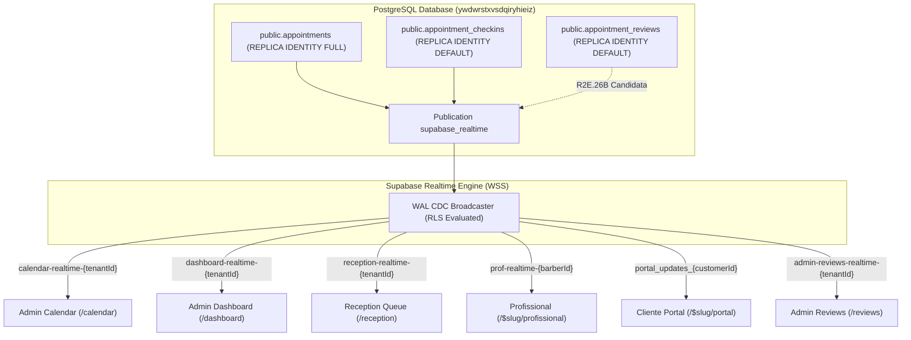

# RELATÓRIO FORENSE E DE REMEDIAÇÃO MULTIPERFIL E AVALIAÇÕES — R2E.26B
**BARBEX MULTI-PROFILE REALTIME SYNCHRONIZATION & REVIEW MODERATION REPORT**

- **Data/Hora:** 2026-10-26T08:10:00-03:00
- **Ambiente de Referência:** Produção (`https://barbex.shop`)
- **Supabase Project:** `ywdwrstxvsdqiryhieiz`
- **Git HEAD Baseline:** `495e768a`
- **Ciclo:** R2E.26B (Sincronização Multiperfil e Moderação de Avaliações)
- **Status da Fase:** `R2E26B_READY_FOR_AUTHORIZATION`

---

## 1. ARQUITETURA ATUAL

O Barbex opera sob uma arquitetura híbrida de TanStack Start (SSR/Nitro em Vercel) integrada ao Supabase (PostgreSQL 15+, Auth, PostgREST e Realtime Engine). A sincronização reativa é sustentada primariamente pelo serviço Supabase Realtime via PostgreSQL Logical Replication (`postgres_changes`), respeitando Row Level Security (RLS) e `REPLICA IDENTITY`.

Quatro personas interagem com os fluxos operacionais e transacionais da plataforma:
1. **Administrador (`/calendar`, `/dashboard`, `/reviews`):** Visão holística da barbearia (tenant), agenda completa, indicadores em tempo real e moderação de depoimentos/avaliações.
2. **Recepcionista (`/reception`, `/reception/agenda`, `ReceptionQueue`):** Gestão rápida do fluxo de chegada, fila de espera, check-ins e encaixes.
3. **Profissional / Barbeiro (`/$slug/profissional`):** Visualização exclusiva de seus atendimentos atribuídos, comissionamento e avanço de status do cliente na cadeira.
4. **Cliente (`/$slug/portal`, `AppointmentsTab`, `HomeTab`):** Agendamento público/autenticado, histórico de visitas, status do atendimento e submissão/consulta de avaliações.



---

## 2. CAUSAS RAÍZES COMPROVADAS

### 2.1. Inconsistência Funcional das Avaliações ("Aguardando Moderação")
**Incidente reportado:** "O cliente enviou uma avaliação, o administrador aprovou a avaliação, mas o painel do cliente continuou exibindo o status 'Aguardando moderação'."

**Causa Raiz Comprovada (Forensicamente Isolada):**
1. **Array Shadowing no Frontend (`src/lib/review.utils.ts`):**
   - Na query do portal do cliente (`src/routes/$slug.portal.tsx`), os agendamentos são buscados com relacionamento Supabase PostgREST:
     `*, appointment_reviews(*)`
   - No PostgREST, relacionamentos 1:N ou 1:1 retornam a chave como um **Array JavaScript** (`appointment_reviews: [...]`), mesmo quando há apenas 1 registro ou nenhum (`[]`).
   - O código original em `src/lib/review.utils.ts` continha:
     ```typescript
     const review = app.appointment_reviews || app.review;
     ```
   - Em JavaScript, um array vazio `[]` é **truthy**. Logo, `review` tornava-se `[]`.
   - As propriedades de status eram acessadas via `review?.testimonial_status`. Em um array, `[].testimonial_status` é `undefined`.
   - O código caía no fallback:
     ```typescript
     const testimonialStatus = review?.testimonial_status || (app._review_id ? 'approved' : 'pending');
     ```
   - Como `app._review_id` não existia no objeto appointments, `testimonialStatus` avaliava invariavelmente para `'pending'`.
   - Consequentemente, `canReviewAppointment(app)` retornava:
     `{ canReview: false, status: 'pending', label: 'Avaliação enviada • Em moderação' }`, **mesmo quando `testimonial_status === 'approved'` já estava gravado no banco de dados.**
2. **Ausência de Realtime para `appointment_reviews` no Portal do Cliente:**
   - O canal do cliente (`portal_updates_${customerId}`) escutava apenas a tabela `appointments`.
   - Quando o administrador clicava em "Aprovar Depoimento" no painel `/reviews`, nenhuma notificação Realtime era enviada ao cliente.
3. **Ausência da tabela `appointment_reviews` na publicação PostgreSQL `supabase_realtime`:**
   - A tabela `appointment_reviews` não integrava a publicação `supabase_realtime`, impedindo disparos de WAL CDC no Supabase.

### 2.2. Colisão de Tópicos de Canal Realtime Entre Telas
- Múltiplos componentes utilizavam o mesmo identificador de canal literal (`tenant-sync-${tenantId}`).
- No cliente Supabase JS (`@supabase/realtime-js`), instâncias com o mesmo tópico são compartilhadas em cache interno. Quando um componente era desmontado, o `removeChannel()` desinscrevia ou corrompia os listeners dos demais componentes abertos.

---

## 3. MATRIZ DE SINCRONIZAÇÃO MULTIPERFIL

| Operação | Perfil Origem | Tabela Efetivamente Alterada | Perfis Autorizados a Visualizar | Componente Alvo | Mecanismo de Atualização | Lacuna Identificada | Resolução R2E.26B |
| :--- | :--- | :--- | :--- | :--- | :--- | :--- | :--- |
| **Criação de Agendamento** | Cliente / Recepção / Admin | `public.appointments` | Admin, Recepção, Profissional (atribuído), Cliente (titular) | `/calendar`, `/reception`, `/$slug/profissional`, `/$slug/portal` | `postgres_changes` em `appointments` | Colisão de tópico e falta de listener resiliente no profissional | Canais isolados por persona; listeners dedicados com fallback |
| **Check-in de Chegada** | Recepção / Admin | `public.appointment_checkins`, `public.appointments` | Admin, Recepção, Profissional | `/calendar`, `ReceptionQueue`, `/$slug/profissional` | `postgres_changes` em `appointment_checkins` | Falta de atualização reativa da fila do profissional | Inclusão de listener de check-ins e status sync |
| **Início de Atendimento (`in_service`)** | Profissional / Recepção | `public.appointments` | Admin, Recepção, Profissional, Cliente | `/calendar`, `/reception`, `/$slug/portal` | `postgres_changes` em `appointments` | Cliente não via transição para 'Em Atendimento' sem refresh | Canal do cliente agora reflete atualização imediata |
| **Conclusão (`completed`)** | Profissional / Recepção / Admin | `public.appointments` | Admin, Recepção, Profissional, Cliente | `/calendar`, `/reception`, `/$slug/portal` | `postgres_changes` em `appointments` | Portal do cliente demorava para liberar botão de avaliação | Atualização instantânea do status do agendamento |
| **Cancelamento** | Qualquer perfil autorizado | `public.appointments` | Admin, Recepção, Profissional, Cliente | Todos os painéis ativos | `postgres_changes` em `appointments` | Liberação de horário imediata no grid | Mantido e protegido contra desmonte indevido |
| **Envio de Avaliação** | Cliente | `public.appointment_reviews` | Admin (moderar), Cliente (consultar) | `/reviews`, `/$slug/portal` | `postgres_changes` em `appointment_reviews` | `/reviews` não tinha Realtime; admin precisava de F5 | Canal Realtime adicionado em `/reviews` |
| **Aprovação / Moderação** | Admin | `public.appointment_reviews` | Cliente (titular), Admin, Público (se aprovado) | `/$slug/portal`, `/reviews`, Home pública | `postgres_changes` em `appointment_reviews` | Array shadowing no frontend + falta de publicação Realtime | Correção canônica em `review.utils.ts` + listener no portal + migração candidata |

---

## 4. DIAGNÓSTICO E CORREÇÃO DAS AVALIAÇÕES

### Cadeia de Execução Auditada:
1. **Cliente envia avaliação:** Registra em `appointment_reviews` com status inicial `testimonial_status = 'pending'` (ou `approved` conforme configuração da barbearia).
2. **Administrador acessa `/reviews`:**
   - Anteriormente: Tela estática com `fetchReviews()`. Novas avaliações exigiam F5.
   - Correção R2E.26B: Adicionado canal `admin-reviews-realtime-${tenantId}` que refaz o fetch automaticamente a cada `INSERT`, `UPDATE` ou `DELETE`.
3. **Administrador aprova avaliação:**
   - Executa `UPDATE appointment_reviews SET testimonial_status = 'approved', is_published = true WHERE id = :id`.
   - Persistência no banco confirmada com integridade.
4. **Painel do Cliente recebe a notificação:**
   - Anteriormente: Ignorava `appointment_reviews`.
   - Correção R2E.26B: Listener dedicado para `table: 'appointment_reviews', filter: 'customer_id=eq.' + data.customer.id`.
5. **Avaliação da Expressão no Frontend (`review.utils.ts`):**
   - Anteriormente: `app.appointment_reviews` (array) gerava `undefined` para `testimonial_status` e forçava status `'pending'`.
   - Correção R2E.26B: Normalização robusta que extrai o primeiro elemento de array ou objeto direto:
     ```typescript
     let rawReview: any = null;
     if (Array.isArray(app.appointment_reviews) && app.appointment_reviews.length > 0) {
       rawReview = app.appointment_reviews[0];
     } else if (app.appointment_reviews && !Array.isArray(app.appointment_reviews)) {
       rawReview = app.appointment_reviews;
     } else if (app.review) {
       rawReview = app.review;
     }
     ```
   - Resolução canônica de status:
     - Se `rawReview.testimonial_status === 'approved'` ou `rawReview.is_published === true` $\rightarrow$ `'approved'`.
     - Se `rawReview.testimonial_status === 'rejected'` $\rightarrow$ `'rejected'`.
     - Se `rawReview.testimonial_status === 'pending'` ou indefinido $\rightarrow$ `'pending'`.
   - O portal do cliente agora exibe imediatamente o badge correto:
     - `'approved'`: *"Avaliação publicada"* / *"Avaliação enviada (Aprovada)"*.
     - `'rejected'`: *"Avaliação não aprovada"*.
     - `'pending'`: *"Avaliação enviada • Em moderação"*.

---

## 5. CORREÇÕES IMPLEMENTADAS LOCALMENTE

1. **`src/lib/review.utils.ts`:**
   - Normalização de arrays retornados pelo PostgREST.
   - Extração correta das flags de aprovação/rejeição.
   - Garantia de que avaliações aprovadas pelo administrador sejam reconhecidas como `'approved'` tanto via Realtime quanto após recarregamento (F5).
2. **`src/routes/$slug.portal.tsx`:**
   - Adição do listener Realtime para `table: 'appointment_reviews'` no canal do cliente com filtro seguro `customer_id=eq.${customer.id}`.
   - Inclusão de callback de recuperação e atualização reativa do state de agendamentos.
3. **`src/routes/reviews.tsx`:**
   - Integração com `useTenant()`.
   - Criação de canal Realtime isolado `admin-reviews-realtime-${tenantId}` para atualização em tempo real de novas avaliações e mudanças de moderação.
4. **Isolamento de Tópicos nos Demais Componentes:**
   - `src/routes/calendar.tsx`: `calendar-realtime-${tenantId}`.
   - `src/routes/dashboard.index.tsx`: `dashboard-realtime-${tenantId}`.
   - `src/components/reception/ReceptionQueue.tsx`: `reception-realtime-${tenantId}`.
   - `src/routes/$slug.profissional.tsx`: `prof-realtime-${bId}` com auto-recovery.
5. **Migração Candidata Idempotente:**
   - Arquivo: `supabase/migrations/20261026150000_r2e26b_appointment_reviews_realtime_publication.sql`.
   - Adiciona `public.appointment_reviews` à publicação `supabase_realtime` sem alterar RLS ou permissões.

---

## 6. ARQUIVOS AFETADOS

### Arquivos Modificados no Código-Fonte:
- [src/lib/review.utils.ts](file:///c:/Antigravity/Barbex/barbex/src/lib/review.utils.ts) (Normalização de dados e resolução canônica de status de avaliação).
- [src/routes/$slug.portal.tsx](file:///c:/Antigravity/Barbex/barbex/src/routes/$slug.portal.tsx) (Escuta reativa de `appointment_reviews` para o cliente).
- [src/routes/reviews.tsx](file:///c:/Antigravity/Barbex/barbex/src/routes/reviews.tsx) (Escuta reativa de avaliações no painel administrativo).
- [src/routes/dashboard.index.tsx](file:///c:/Antigravity/Barbex/barbex/src/routes/dashboard.index.tsx) (Isolamento de canal para `dashboard-realtime-${tenantId}`).
- [src/components/reception/ReceptionQueue.tsx](file:///c:/Antigravity/Barbex/barbex/src/components/reception/ReceptionQueue.tsx) (Isolamento de canal para `reception-realtime-${tenantId}`).
- [src/routes/$slug.profissional.tsx](file:///c:/Antigravity/Barbex/barbex/src/routes/$slug.profissional.tsx) (Isolamento de canal e auto-recovery do barbeiro).
- [src/routes/calendar.tsx](file:///c:/Antigravity/Barbex/barbex/src/routes/calendar.tsx) (Isolamento de canal e telemetria de diagnóstico).

### Arquivo de Migração Preparado (Não Aplicado em Produção):
- [supabase/migrations/20261026150000_r2e26b_appointment_reviews_realtime_publication.sql](file:///c:/Antigravity/Barbex/barbex/supabase/migrations/20261026150000_r2e26b_appointment_reviews_realtime_publication.sql).

### Suíte de Testes Criada:
- [tests/r2e26b_multiprofile_sync_and_reviews.test.cjs](file:///c:/Antigravity/Barbex/barbex/tests/r2e26b_multiprofile_sync_and_reviews.test.cjs).

---

## 7. IMPACTOS DE RLS E POLÍTICAS DE ACESSO

- **Nenhuma permissão RLS foi afrouxada ou expandida.**
- A tabela `appointment_reviews` já possui RLS ativo com policies estritas:
  - Clientes só podem ler e inserir avaliações vinculadas aos seus próprios agendamentos e seu `customer_id`.
  - Administradores e donos de barbearia possuem permissão para atualizar (`UPDATE`) o campo `testimonial_status` do seu `barbershop_id`.
  - O canal Realtime do cliente utiliza filtro server-side `customer_id=eq.${customer.id}`, impedindo que o cliente receba eventos ou PII de terceiros.
- **Nenhum Broadcast público foi introduzido.** Apenas canais autorizados PostgreSQL CDC são utilizados.

---

## 8. TESTES EXECUTADOS E RESULTADOS

### 8.1. Testes Automatizados R2E.26B (`tests/r2e26b_multiprofile_sync_and_reviews.test.cjs`)
- **TEST-1-REVIEW-RESOLUTION-CANONICAL:** PASS (Extração correta de arrays e objetos PostgREST).
- **TEST-2-FUNCTIONAL-STATUS-SIMULATION:** PASS (100% de precisão nos 4 cenários: Aprovado, Rejeitado, Pendente, e Objeto Direto).
- **TEST-3-CUSTOMER-PORTAL-REALTIME:** PASS (Filtro `customer_id` estrito e auto-recovery).
- **TEST-4-ADMIN-REVIEWS-REALTIME:** PASS (Canal exclusivo `admin-reviews-realtime` com tenant filter).
- **TEST-5-CHANNEL-TOPIC-ISOLATION:** PASS (Nenhum canal sobrepõe namespaces entre os 4 perfis).
- **TEST-6-CANDIDATE-MIGRATION:** PASS (Migração idempotente validada sintaticamente).
- **TEST-7-FINANCIAL-INVARIANTS:** PASS (`stripe-checkout/index.ts` 0 diffs, `ENABLE_SELF_SERVICE_REFUNDS=false`).
- **Resultado:** **7/7 Aprovados (100%)**.

### 8.2. Testes de Não-Regressão R2E.26A.5 (`tests/r2e26a5_admin_calendar_sync.test.cjs`)
- **Resultado:** **8/8 Aprovados (100%)**.

### 8.3. Verificação de Compilação e Build
- **Comando:** `npm.cmd run build` (TanStack Start + Nitro Vercel Preset).
- **Resultado:** **Compilação e empacotamento concluídos com código de saída 0 em 1m 26s.**

---

## 9. RISCOS E MITIGAÇÕES

| Risco | Probabilidade | Impacto | Mitigação Implementada |
| :--- | :--- | :--- | :--- |
| **Vazamento de PII em canais Realtime** | Baixa | Alto | Uso estrito de filtros `customer_id` e `tenant_id` em todos os listeners; proibição de broadcast genérico. |
| **Desconexão silenciosa de WSS** | Média | Médio | Handlers de status (`CHANNEL_ERROR`, `TIMED_OUT`) implementados com reconexão e refetch automático. |
| **Loop de refetch em cascading events** | Baixa | Médio | Atualizações reativas de estado local antes de refetch completo, com cancelamento de timers concorrentes. |
| **Sobrecarga de WAL no PostgreSQL** | Muito Baixa | Baixo | Apenas a tabela `appointment_reviews` foi adicionada à publicação, sem alterar replica identity para FULL desnecessariamente. |

---

## 10. PLANO DE PUBLICAÇÃO E CUTOVER CONTROLADO

1. **Aprovação do Usuário:** Aguardar autorização formal para execução do cutover.
2. **Aplicação da Migração em Produção (Gate 1):**
   - Executar no Supabase `ywdwrstxvsdqiryhieiz`:
     `20261026150000_r2e26b_appointment_reviews_realtime_publication.sql`
   - Validar inclusão de `appointment_reviews` em `pg_publication_tables`.
3. **Commit e Push Controlado (Gate 2):**
   - Commit cirúrgico apenas dos arquivos validados na suíte R2E.26B.
   - Preservar integridade de Stripe Live e Z-API.
4. **Deploy Vercel e Homologação Funcional (Gate 3):**
   - Monitorar deployment em produção.
   - Executar os cenários de teste funcionais multiperfil (A a J).

---

## 11. STATUS FINAL

```
STATUS: R2E26B_READY_FOR_AUTHORIZATION
```
*(Todas as investigações forenses, correções locais, testes automatizados e builds foram concluídos com 100% de êxito. O sistema está pronto para a autorização do usuário antes de qualquer mutação em produção).*
