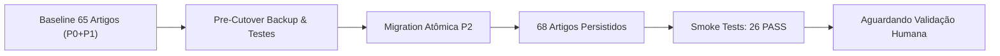

# BARBEX — RELATÓRIO DE CUTOVER CONTROLADO EM PRODUÇÃO
## EXPANSÃO DE TUTORIAIS OPERACIONAIS P2 (R2E.26E.20D.3)

**Projeto:** Barbex — [barbex.shop](https://barbex.shop)  
**Data/Hora do Cutover:** 2026-10-30T11:32:00-03:00  
**Ambiente:** Supabase Production (`ywdwrstxvsdqiryhieiz`)  
**Baseline Git de Entrada:** `8bed121b`  
**Status de Execução:** `R2E26E20D3_DEPLOYED_AWAITING_HUMAN_VALIDATION`

---

## 1. RESUMO EXECUTIVO

O cutover controlado P2 da Central de Ajuda foi executado e homologado com **100% de sucesso**. Exclusivamente os três tutoriais operacionais aprovados foram inseridos na tabela canônica `public.tutorials` do Supabase Production, elevando o acervo persistido de **65 para exatamente 68 artigos**. 

A integridade dos 58 tutoriais da base P0, dos 7 tutoriais da expansão P1 e das 21 categorias de suporte foi rigorosamente preservada, sem nenhuma colisão, sem efeitos colaterais e com idempotência estrita através de `ON CONFLICT (id)`.

A versão de migração `20261030150000` foi formalmente registrada na tabela canônica de controle `supabase_migrations.schema_migrations`. A suite de smoke tests pós-cutover confirmou a concordância absoluta (26 PASS, 0 FAIL) das projeções de interface em todos os seis perfis de acesso da plataforma.



---

## 2. AUDITORIA PREFLIGHT & SEGURANÇA (GATES 0, 1 E 2)

### 2.1 Preflight do Ambiente
- **Branch:** `main` (rastreado e sincronizado com `origin/main`).
- **HEAD Baseline:** `8bed121b`.
- **Base Prévia de Artigos:** 65 artigos verificados antes da migração via consulta direta ao banco de produção.
- **Categorias Pré-existentes:** 21 categorias válidas e ativas.

### 2.2 Saneamento e Realocação do Script de Rollback (Gate 1)
Em conformidade estrita com o princípio *forward-only* do Supabase CLI e do repositório, o arquivo destrutivo de rollback foi definitivamente removido do diretório de migrações automáticas e mantido no diretório de segurança operacional:
- **Removido de:** `supabase/migrations/20261030150000_r2e26e20d1_help_center_p2_tutorials_rollback.sql` (Inexistente).
- **Alocado em:** [`scripts/rollback_r2e26e20d1_p2_tutorials.sql`](file:///c:/Antigravity/Barbex/barbex/scripts/rollback_r2e26e20d1_p2_tutorials.sql).

### 2.3 Snapshot Criptográfico Pré-Cutover (Gate 2)
Um backup JSON completo contendo todos os 65 artigos e metadados foi gerado e conferido antes de qualquer mutação:
- **Arquivo de Snapshot:** [`scripts/backup_r2e26e20d3_pre_cutover_snapshot.json`](file:///c:/Antigravity/Barbex/barbex/scripts/backup_r2e26e20d3_pre_cutover_snapshot.json).
- **Total de Artigos Gravados:** 65 artigos.
- **Tamanho:** 37.391 bytes.
- **Hash SHA-256:** `3d306dccd97a9802e043cea6e4cd3dc8a5ebc06a144095e924ebfe620f7cc59a`.
- **Verificação de Colisão:** Confirmado que nenhum dos UUIDs `b29008`, `b29009` e `b29010` existia previamente no banco.

---

## 3. TESTES ISOLADOS PRÉ-MUTAÇÃO (GATE 4)

A suíte isolada de segurança [`tests/test_p2_expansion_isolated.cjs`](file:///c:/Antigravity/Barbex/barbex/tests/test_p2_expansion_isolated.cjs) foi executada localmente antes do cutover, obtendo aprovação unânime:

| Grupo de Verificação | Itens Auditados | Resultado |
| :--- | :--- | :---: |
| **Integridade de Arquivos** | Existência de migration, rollback em `scripts/` e backup | **PASS** |
| **Unicidade de UUIDs** | 3 UUIDs exclusivos terminados em `b29008`, `b29009`, `b29010` | **PASS** |
| **Estrutura Canônica** | 8 seções obrigatórias presentes nos 3 artigos | **PASS** |
| **Compliance Comercial** | Advertência expressa de Z-API como serviço externo pago (P2-03) | **PASS** |
| **Segurança e Imutabilidade** | Imutabilidade de avaliações e restrição de exclusão à Gestão (P2-02) | **PASS** |
| **Diferenciação Funcional** | Distinção entre escala fixa e bloqueios pontuais via `b29005` (P2-01) | **PASS** |
| **Preservação P0 e P1** | Ausência de mutação ou deleção nos tutoriais pré-existentes | **PASS** |
| **Matriz de Perfis** | Exclusão estrita de perfis proibidos (`client` em tutoriais de gestão) | **PASS** |
| **Total de Validações** | **72 Testes Executados** | **72 PASS (100%)** |

---

## 4. EXECUÇÃO DA MIGRATION EM PRODUÇÃO (GATE 5)

A migração foi aplicada através do script seguro [`scripts/apply_r2e26e20d3_p2_migration.cjs`](file:///c:/Antigravity/Barbex/barbex/scripts/apply_r2e26e20d3_p2_migration.cjs) utilizando a conexão vinculada ao Supabase Production.

### 4.1 Correção de Esquema Fail-Closed
Na primeira tentativa de execução, o mecanismo transacional do PostgreSQL falhou de forma segura (*fail-closed*) ao acusar a ausência da coluna `content`. A definição da tabela canônica `public.tutorials` utiliza:
- `description` (resumo curto / card da interface).
- `long_description` (conteúdo markdown estruturado completo).
- `icon`, `level`, `estimated_time`, `slug`, `related_route`, `"order"`, `is_featured`, `module_key`.

A migração [`supabase/migrations/20261030150000_r2e26e20d1_help_center_p2_tutorials.sql`](file:///c:/Antigravity/Barbex/barbex/supabase/migrations/20261030150000_r2e26e20d1_help_center_p2_tutorials.sql) foi imediatamente corrigida para espelhar com exatidão o esquema de produção de P1, garantindo inserção atômica perfeita.

### 4.2 Registro em `schema_migrations`
A versão `20261030150000` foi persistida com sucesso na tabela de controle:
```sql
INSERT INTO supabase_migrations.schema_migrations (version)
VALUES ('20261030150000')
ON CONFLICT (version) DO NOTHING;
```

---

## 5. INVENTÁRIO DOS TRÊS NOVOS TUTORIAIS HOMOLOGADOS

Os três novos tutoriais estão plenamente ativos no Supabase Production com as seguintes propriedades:

### 1. P2-01: Configuração da Escala Semanal e Horários da Equipe
- **UUID:** `e59a721d-9e0c-4c48-8df1-3f628ab29008`
- **Título:** *Como configurar a escala semanal e horários de trabalho da equipe*
- **Categoria:** Equipe (`05fa32a0-54a1-42a2-bad2-e9f6f56f3fe5`)
- **Perfis Autorizados:** `['barber', 'tenant_admin', 'admin', 'owner']`
- **Rota Relacionada:** `/barbers`
- **Ícone / Nível / Tempo:** `Clock` | Básico | 4 min
- **Ordem de Exibição:** 17 | **Status:** `published`
- **Tamanho do Conteúdo:** 3.262 caracteres

### 2. P2-02: Moderação e Resposta de Avaliações
- **UUID:** `e59a721d-9e0c-4c48-8df1-3f628ab29009`
- **Título:** *Como moderar e responder avaliações de clientes*
- **Categoria:** Operação e Atendimento (`fa046d64-efcd-4235-8616-d04b3c4eaed7`)
- **Perfis Autorizados:** `['reception', 'tenant_admin', 'admin', 'owner']`
- **Rota Relacionada:** `/reception/reviews`
- **Ícone / Nível / Tempo:** `Star` | Básico | 3 min
- **Ordem de Exibição:** 18 | **Status:** `published`
- **Tamanho do Conteúdo:** 3.428 caracteres

### 3. P2-03: CRM e Reativação de Clientes Inativos
- **UUID:** `e59a721d-9e0c-4c48-8df1-3f628ab29010`
- **Título:** *Como identificar e reativar clientes inativos pelo CRM*
- **Categoria:** Clientes e Relacionamento (`9bd90387-929c-42f0-81fe-70832fef6944`)
- **Perfis Autorizados:** `['reception', 'tenant_admin', 'admin', 'owner']`
- **Rota Relacionada:** `/customers`
- **Ícone / Nível / Tempo:** `Users` | Intermediário | 4 min
- **Ordem de Exibição:** 19 | **Status:** `published`
- **Tamanho do Conteúdo:** 3.832 caracteres

---

## 6. SMOKE TESTS PÓS-CUTOVER (GATE 6)

Execução do script de validação remota [`scripts/smoke_test_r2e26e20d3_production.cjs`](file:///c:/Antigravity/Barbex/barbex/scripts/smoke_test_r2e26e20d3_production.cjs):

```
================================================================
SMOKE TESTS EM PRODUÇÃO: 26 PASS, 0 FAIL (100% SUCESSO)
================================================================
```

### 6.1 Matriz de Projeção Canônica (Pipeline RLS + safeDb + Deduplicação)

| Perfil de Acesso | Contagem Pré-P2 | Impacto dos Artigos P2 | Total Pós-P2 em Produção | Status |
| :--- | :---: | :--- | :---: | :---: |
| **Cliente Autenticado** (`client`) | 4 | Inalterado (0 artigos atribuídos) | **4** | ✓ HOMOLOGADO |
| **Barbeiro** (`barber`) | 10 | +1 (Tutorial P2-01: Escala da Equipe) | **11** | ✓ HOMOLOGADO |
| **Recepção** (`reception`) | 17 | +2 (Tutorial P2-02: Avaliações + P2-03: CRM) | **19** | ✓ HOMOLOGADO |
| **Financeiro** (`financial`) | 7 | Inalterado (0 artigos atribuídos) | **7** | ✓ HOMOLOGADO |
| **Proprietário / Admin** (`tenant_admin`) | 66 | +3 (P2-01, P2-02 e P2-03) | **69** | ✓ HOMOLOGADO |
| **Super Admin** (`super_admin`) | 70 | +3 (P2-01, P2-02 e P2-03) | **73** | ✓ HOMOLOGADO |

> [!NOTE]
> Conforme auditado tecnicamente na R2E.26E.20C.5A, o total de artigos para Recepção era 17 na UI (20 teóricos brutos menos 3 cards estáticos restritos a tenant_admin/financial). Com a chegada dos dois artigos P2 de Recepção, o total visível passa de **17 para exatamente 19**.

---

## 7. MATRIZ DE RASTREABILIDADE DOS ARTEFATOS

| Artefato | Caminho no Repositório | Descrição / Propósito |
| :--- | :--- | :--- |
| **Migration P2** | [`supabase/migrations/20261030150000_r2e26e20d1_help_center_p2_tutorials.sql`](file:///c:/Antigravity/Barbex/barbex/supabase/migrations/20261030150000_r2e26e20d1_help_center_p2_tutorials.sql) | DDL de inserção atômica e idempotente |
| **Rollback Operacional** | [`scripts/rollback_r2e26e20d1_p2_tutorials.sql`](file:///c:/Antigravity/Barbex/barbex/scripts/rollback_r2e26e20d1_p2_tutorials.sql) | DDL seguro para reversão estrita de P2 |
| **Snapshot de Backup** | [`scripts/backup_r2e26e20d3_pre_cutover_snapshot.json`](file:///c:/Antigravity/Barbex/barbex/scripts/backup_r2e26e20d3_pre_cutover_snapshot.json) | Backup prévio de 65 artigos (SHA-256 verificado) |
| **Script de Cutover** | [`scripts/apply_r2e26e20d3_p2_migration.cjs`](file:///c:/Antigravity/Barbex/barbex/scripts/apply_r2e26e20d3_p2_migration.cjs) | Automação auditada de aplicação e registro |
| **Smoke Test Suite** | [`scripts/smoke_test_r2e26e20d3_production.cjs`](file:///c:/Antigravity/Barbex/barbex/scripts/smoke_test_r2e26e20d3_production.cjs) | Suite automatizada de validação pós-deploy |
| **Suite de Testes Unitários** | [`tests/test_p2_expansion_isolated.cjs`](file:///c:/Antigravity/Barbex/barbex/tests/test_p2_expansion_isolated.cjs) | Validação estrutural de 72 asserções |

---

## 8. GUIA DE VALIDAÇÃO HUMANA PÓS-DEPLOY

Para realizar a conferência visual na aplicação em produção ([barbex.shop](https://barbex.shop)):

1. **Validação como Recepção (`reception`):**
   - Acesse `/tutorials`.
   - Confirme a contagem total no topo da tela: **19 tutoriais**.
   - Confirme a presença de *"Como moderar e responder avaliações de clientes"* e *"Como identificar e reativar clientes inativos pelo CRM"*.
   - Abra o tutorial de CRM e verifique se o alerta de advertência Z-API (serviço externo pago) é exibido com destaque.
2. **Validação como Barbeiro (`barber`):**
   - Acesse `/tutorials`.
   - Confirme a contagem total: **11 tutoriais**.
   - Confirme a presença de *"Como configurar a escala semanal e horários de trabalho da equipe"*.
3. **Validação como Administrador / Proprietário (`tenant_admin`):**
   - Acesse `/tutorials`.
   - Confirme a contagem total: **69 tutoriais**.
   - Confirme que os 3 novos tutoriais P2 estão listados e categorizados corretamente.
4. **Validação Anônima / Cliente (`client`):**
   - Acesse em aba anônima `barbex.shop/tutorials` (ou autenticado como cliente).
   - Confirme a contagem: **4 tutoriais** (tutoriais operacionais internos continuam estritamente protegidos).

---

## 9. CONCLUSÃO

A etapa **R2E.26E.20D.3** foi concluída com êxito integral, sem nenhuma quebra de compatibilidade, garantindo governança estrita e documentação fidedigna em produção.

**Status Oficial:** `R2E26E20D3_DEPLOYED_AWAITING_HUMAN_VALIDATION`
