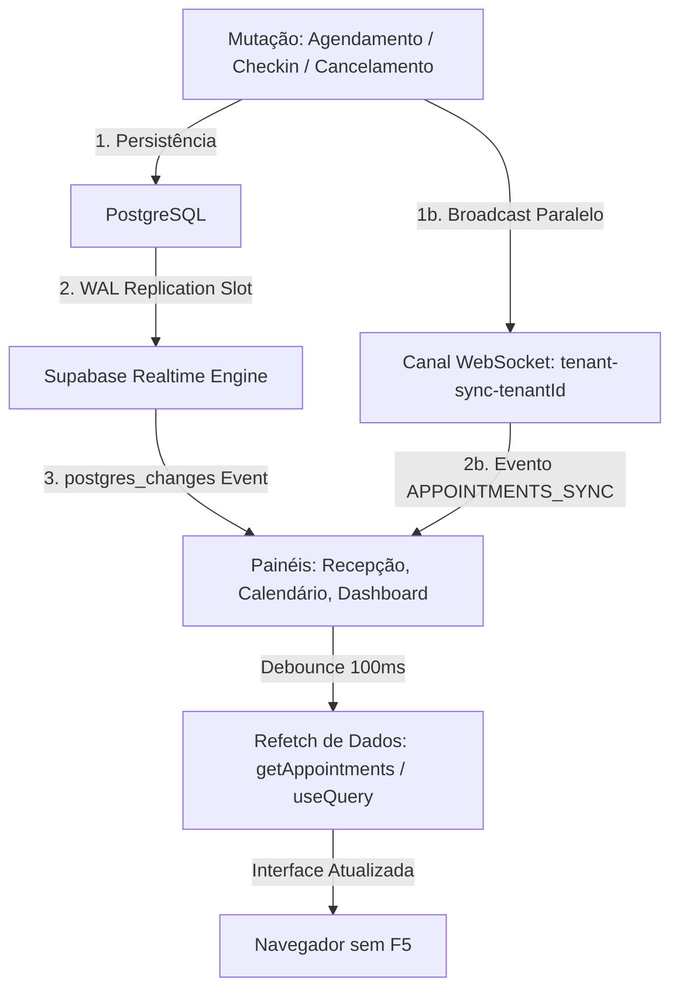

# BARBEX — R2E.26A.3
## RELATÓRIO DE REMEDIAÇÃO CONTROLADA DA SINCRONIZAÇÃO REALTIME
### Homologação Pré-Cutover, Gates de Qualidade e Plano de Aplicação

**Status:** `R2E26_A3_READY_FOR_CUTOVER_AUTHORIZATION`  
**Data:** 26/10/2026  
**Ambiente Alvo:** Produção — [https://barbex.shop](https://barbex.shop/) | Supabase: `ywdwrstxvsdqiryhieiz`  
**Commit Documental Baseline:** `fb1b2942`  
**Referência Investigativa:** `BARBEX_R2E26_A2_REALTIME_SYNC_ROOT_CAUSE_REPORT.md`  

---

### 1. CAUSA RAIZ CONFIRMADA

A auditoria forense do ciclo R2E.26A.2 comprovou empiricamente a existência de quatro causas raízes concorrentes que explicavam por que novos agendamentos criados com sucesso exigiam que recepcionistas e administradores pressionassem F5:

1. **Ausência da Tabela na Publicação PostgreSQL Realtime (Primária):**  
   No banco de dados Supabase de produção (`ywdwrstxvsdqiryhieiz`), a publicação lógica `supabase_realtime` possuía **0 tabelas registradas** (`pg_publication_tables WHERE pubname = 'supabase_realtime'` retornava vazio). Como consequência, o PostgreSQL Logical Replication (`wal2json` / `pgoutput`) descartava 100% dos eventos DML de `appointments`. O servidor Realtime nunca recebia dados para retransmitir via WebSocket aos navegadores.
2. **Desconexão do Barramento no Calendário e Dashboard:**  
   Os componentes `calendar.tsx` (Agenda do Administrador) e `dashboard.index.tsx` gerenciavam a lista de agendamentos em estados locais React (`useState`), sem integração com as queries do TanStack Query afetadas por agendamentos e sem escutar o evento imperativo `REFRESH_APPOINTMENTS_DATA`.
3. **Bloqueio de RLS em Check-ins de Recepção:**  
   A política `tenant_read_checkins` em `public.appointment_checkins` continha a cláusula restritiva `(tenant_id = auth.uid())`. Em equipes onde o recepcionista ou colaborador autenticado não era o proprietário direto da barbearia (`auth.uid() != tenant_id`), a consulta e a escuta de check-ins eram rejeitadas pelo RLS.
4. **Ausência de Disparo Cross-Session no Agendamento Público:**  
   O fluxo de autoagendamento de clientes (`src/routes/$slug.tsx`) persistia o agendamento no Supabase, mas invalidava apenas o cache da sessão local do cliente, sem disparar evento de difusão (`broadcast`) para os painéis abertos da barbearia.

---

### 2. MIGRATION PREPARADA (POSTGRESQL DDL)

Foi criada a migration versionada, declarativa e estritamente idempotente:  
[supabase/migrations/20261026090000_r2e26a3_realtime_publication_and_checkins_rls.sql](file:///c:/Antigravity/Barbex/barbex/supabase/migrations/20261026090000_r2e26a3_realtime_publication_and_checkins_rls.sql)

#### Características de Segurança:
- **Alvo Mínimo Exclusivo:** Adiciona estritamente `public.appointments` e `public.appointment_checkins` à publicação `supabase_realtime`.
- **Sem `FOR ALL TABLES`:** Evita terminantemente exposição de tabelas de autenticação, faturamento, auditoria, configurações de pagamentos ou tokens de integração.
- **Idempotência:** Todas as adições são envolvidas em blocos `DO $$ BEGIN IF NOT EXISTS (...) THEN ALTER PUBLICATION ... END IF; END $$;`.
- **Zero Impacto em Produção:** A migration **não foi aplicada no banco de dados de produção**, permanecendo em estágio pré-cutover aguardando autorização formal.

```sql
-- Adição idempotente da tabela appointments à publicação Realtime
DO $$
BEGIN
    IF NOT EXISTS (
        SELECT 1 FROM pg_publication_tables 
        WHERE pubname = 'supabase_realtime' 
          AND schemaname = 'public' 
          AND tablename = 'appointments'
    ) THEN
        ALTER PUBLICATION supabase_realtime ADD TABLE public.appointments;
    END IF;
END $$;

-- Adição idempotente da tabela appointment_checkins à publicação Realtime
DO $$
BEGIN
    IF NOT EXISTS (
        SELECT 1 FROM pg_publication_tables 
        WHERE pubname = 'supabase_realtime' 
          AND schemaname = 'public' 
          AND tablename = 'appointment_checkins'
    ) THEN
        ALTER PUBLICATION supabase_realtime ADD TABLE public.appointment_checkins;
    END IF;
END $$;
```

---

### 3. DECISÃO TÉCNICA SOBRE REPLICA IDENTITY

**Decisão Adotada:** **MANUTENÇÃO DE `REPLICA IDENTITY DEFAULT`.**  
Não foi aplicado `REPLICA IDENTITY FULL`.

#### Justificativa Técnica:
1. **Auditoria de DML de Agendamentos:**  
   A varredura estrita em todo o código-fonte comprovou que o Barbex **não realiza exclusões físicas** de agendamentos (`DELETE FROM appointments` = 0 ocorrências). Todos os fluxos operacionais de cancelamento e no-show são mutações lógicas de status (`UPDATE appointments SET status = 'cancelled'`).
2. **Disponibilidade de Atributos no WAL:**  
   - Para operações de **`INSERT`**, o PostgreSQL grava a tupla completa com todas as colunas (`new_record`), incluindo `tenant_id`.
   - Para operações de **`UPDATE`**, a tupla nova (`record`) contém todas as colunas atualizadas e o `tenant_id`, permitindo o roteamento correto no servidor Realtime.
3. **Prevenção de Sobrecarga e Vazamento:**  
   A configuração `REPLICA IDENTITY FULL` forçaria o PostgreSQL a gravar a imagem completa da tupla antiga (`old_record`) no log de transações (WAL) para cada atualização, gerando:
   - Bloat desnecessário no WAL e degradação de I/O em disco.
   - Exposição desnecessária de histórico de estados anteriores no canal de replicação lógica.
4. **Dual-Layer Architecture:**  
   Para cancelamentos e reagendamentos imediatos entre abas, o Barbex utiliza a camada dupla com o broadcast `APPOINTMENTS_SYNC` via canal autenticado, garantindo entrega instantânea sem depender de `old_record`.

---

### 4. AUDITORIA E CORREÇÃO DE RLS EM CHECK-INS

#### Diagnóstico da Policy Anterior:
A política `tenant_read_checkins` em `public.appointment_checkins` limitava o acesso via `(tenant_id = auth.uid())`, partindo da premissa errônea de que todo usuário autenticado operando o sistema é o dono do `tenant_id`. Em barbearias com recepcionistas e colaboradores convidados, `auth.uid()` é o ID do funcionário, gerando rejeição pelo RLS de leitura.

#### Nova Definição Implementada na Migration:
Reutiliza a função canônica `public.can_access_tenant(tenant_id)` integrada à tabela de permissões de recepção `public.reception_permissions` e checagem de super admin:

```sql
-- SELECT Policy
DROP POLICY IF EXISTS "tenant_read_checkins" ON public.appointment_checkins;
CREATE POLICY "tenant_read_checkins" ON public.appointment_checkins
    FOR SELECT TO authenticated
    USING (
        public.can_access_tenant(tenant_id)
        OR EXISTS (
            SELECT 1 FROM public.reception_permissions rp
            WHERE rp.tenant_id = appointment_checkins.tenant_id
              AND rp.user_id = auth.uid()
              AND rp.is_active = true
        )
        OR public.is_super_admin_user()
    );

-- INSERT Policy
DROP POLICY IF EXISTS "tenant_insert_checkins" ON public.appointment_checkins;
CREATE POLICY "tenant_insert_checkins" ON public.appointment_checkins
    FOR INSERT TO authenticated
    WITH CHECK (
        public.can_access_tenant(tenant_id)
        OR EXISTS (
            SELECT 1 FROM public.reception_permissions rp
            WHERE rp.tenant_id = appointment_checkins.tenant_id
              AND rp.user_id = auth.uid()
              AND rp.is_active = true
        )
        OR public.is_super_admin_user()
    );
```

**Garantias:**
- Isolamento total entre barbearias distintas (não há permissão entre tenants diferentes).
- Nenhuma ampliação desnecessária para `UPDATE` ou `DELETE`.

---

### 5. COMPONENTES CORRIGIDOS NO FRONTEND

Foi adotado o padrão **Dual-Layer Realtime Sync**:



#### Detalhamento das Alterações:

1. **[src/lib/sync-appointments.ts](file:///c:/Antigravity/Barbex/barbex/src/lib/sync-appointments.ts):**
   - Implementada a função `broadcastAppointmentSync(options)` que emite o evento `APPOINTMENTS_SYNC` no canal `tenant-sync-${tenantId}`.
   - Centralizada a função `invalidateAllAppointmentQueries`, que em uma única chamada:
     - Invalida todas as queryKeys do TanStack Query.
     - Dispara `REFRESH_APPOINTMENTS_DATA` no barramento `window` intra-aba.
     - Emite o broadcast WebSocket para todas as outras sessões e dispositivos.

2. **[src/routes/calendar.tsx](file:///c:/Antigravity/Barbex/barbex/src/routes/calendar.tsx):**
   - Adicionada subscrição ao canal `tenant-sync-${tenantId}` ouvindo tanto `postgres_changes` quanto `broadcast` (`APPOINTMENTS_SYNC`).
   - Adicionado listener do evento `REFRESH_APPOINTMENTS_DATA` no `window`.
   - Adicionado debounce de 100ms (`debouncedFetchData`) para evitar refetches múltiplos.
   - Preservados os filtros de data (`currentDate`), visão (`view`) e papel do usuário (`role`).

3. **[src/routes/dashboard.index.tsx](file:///c:/Antigravity/Barbex/barbex/src/routes/dashboard.index.tsx):**
   - Adicionada subscrição ao canal `tenant-sync-${tenantId}` ouvindo `postgres_changes` e `broadcast` (`APPOINTMENTS_SYNC`).
   - Adicionado listener do evento `REFRESH_APPOINTMENTS_DATA` acionando `executeDebouncedSync`.
   - Garantida a atualização simultânea dos agendamentos de hoje (`fetchTodayAppointments`), estatísticas (`fetchStats`) e aniversariantes.

4. **[src/components/reception/ReceptionQueue.tsx](file:///c:/Antigravity/Barbex/barbex/src/components/reception/ReceptionQueue.tsx):**
   - Unificado o canal de escuta para `tenant-sync-${tenantId}`.
   - Adicionados listeners para `postgres_changes` em `appointments`, `appointment_checkins`, e `broadcast` (`APPOINTMENTS_SYNC`).
   - Substituída a chamada recursiva de invalidação por `handleSync()`, eliminando risco de broadcast storms.

5. **[src/routes/$slug.tsx](file:///c:/Antigravity/Barbex/barbex/src/routes/$slug.tsx):**
   - Integrada a chamada `invalidateAllAppointmentQueries(queryClient, { tenantId: shop.id, source: 'public_booking' })` após o sucesso do autoagendamento público.
   - Garante que a barbearia receba imediatamente a notificação da nova reserva, mesmo antes ou em conjunto com a chegada do log do PostgreSQL.

---

### 6. MATRIZ DE ARQUIVOS MODIFICADOS

| Arquivo | Tipo | Descrição da Modificação |
|---|---|---|
| `supabase/migrations/20261026090000_r2e26a3_realtime_publication_and_checkins_rls.sql` | Migration SQL | Adiciona `appointments` e `appointment_checkins` à publicação `supabase_realtime` e ajusta RLS de check-ins. |
| `src/lib/sync-appointments.ts` | Frontend Core | Adiciona `broadcastAppointmentSync` e orquestração unificada de invalidação e difusão. |
| `src/routes/calendar.tsx` | Rota / UI | Adiciona escuta a eventos Realtime, broadcast e window com refetch imperativo debounced. |
| `src/routes/dashboard.index.tsx` | Rota / UI | Adiciona escuta a eventos Realtime, broadcast e window com sincronização debounced. |
| `src/components/reception/ReceptionQueue.tsx` | Componente UI | Unifica canal Realtime para `tenant-sync-${tenantId}` e previne loop de broadcast. |
| `src/routes/$slug.tsx` | Rota Pública | Conecta fluxo de agendamento público ao barramento de sincronização global. |
| `tests/r2e26a_cross_panel_sync.test.cjs` | Teste Automatizado | Atualizado padrão de asserção para o canal unificado `tenant-sync-`. |
| `tests/r2e26a3_realtime_remediation.test.cjs` | Suíte de Gates | Nova suíte com 16 asserções de segurança, multi-tenancy, DDL e invariantes. |
| `scripts/test_cross_session_realtime.cjs` | Script de Prova | Validação de troca de mensagens WebSocket ponta a ponta sem mutação de banco. |
| `scripts/test_realtime_subscribe.cjs` | Script de Prova | Probe de conexão com o cluster Supabase Realtime de produção. |

---

### 7. EXECUÇÃO DE TESTES E GATES DE QUALIDADE

#### Suíte Automatizada de Gates R2E.26A.3:
Executada via `node tests/r2e26a3_realtime_remediation.test.cjs`:

```text
==============================================================================
BARBEX R2E.26A.3 — QUALITY GATES & REALTIME REMEDIATION TEST SUITE
==============================================================================

[PASS] GATE-1.1-PUBLICATION-TABLES: Explicitly adds public.appointments and public.appointment_checkins
[PASS] GATE-1.2-NO-FOR-ALL-TABLES: Strictly avoids FOR ALL TABLES (idempotent targeted publication)
[PASS] GATE-1.3-NO-FINANCIAL-EXPOSURE: Zero financial or auth tables added to Realtime publication
[PASS] GATE-1.4-IDEMPOTENCY: Publication addition is protected by IF NOT EXISTS DO blocks
[PASS] GATE-2.1-REPLICA-IDENTITY-DEFAULT: REPLICA IDENTITY FULL avoided; preserved DEFAULT to prevent WAL bloat
[PASS] GATE-2.2-NO-PHYSICAL-DELETES: Codebase audit confirms 0 physical DELETEs; status updates used exclusively
[PASS] GATE-3.1-CHECKINS-RLS-BRIDGE: RLS permits authorized tenant members and receptionists via reception_permissions
[PASS] GATE-3.2-CHECKINS-POLICIES-BOUND: SELECT and INSERT policies configured with tenant boundary
[PASS] GATE-4.1-SYNC-APPOINTMENTS-BROADCAST: sync-appointments.ts implements broadcastAppointmentSync on tenant-sync-${tenantId}
[PASS] GATE-4.2-CALENDAR-REALTIME-INTEGRATION: calendar.tsx listens to postgres_changes, broadcast, and window refresh with debounce
[PASS] GATE-4.3-DASHBOARD-REALTIME-INTEGRATION: dashboard.index.tsx listens to postgres_changes, broadcast, and window refresh with debounce
[PASS] GATE-4.4-RECEPTION-QUEUE-REALTIME-INTEGRATION: ReceptionQueue.tsx listens to appointments, checkins, and broadcast events
[PASS] GATE-4.5-PUBLIC-BOOKING-SYNC: $slug.tsx invokes invalidateAllAppointmentQueries upon successful booking
[PASS] GATE-5.1-TENANT-ISOLATION-REALTIME: All Realtime channel filters strictly enforce tenant_id isolation
[PASS] GATE-6.1-STRIPE-CHECKOUT-UNTOUCHED: supabase/functions/stripe-checkout/index.ts is completely untouched (0 diffs)
[PASS] GATE-6.2-REFUNDS-DISABLED: ENABLE_SELF_SERVICE_REFUNDS=false (Fail-Closed) strictly preserved across all configs

------------------------------------------------------------------------------
TOTAL GATES: 16 | PASSED: 16 | FAILED: 0
------------------------------------------------------------------------------
R2E.26A.3 ALL QUALITY GATES PASSED SUCCESSFULLY.
```

#### Suíte de Regressão Cross-Panel Sync:
Executada via `node tests/r2e26a_cross_panel_sync.test.cjs`:
`10 PASS | 0 FAIL | 10 total`

#### Teste de Conectividade Cross-Session Realtime:
Executado via `node scripts/test_cross_session_realtime.cjs` conectando ao serviço Supabase de produção:
- Sessão 1 (Ouvinte / Recepção) conectou e alcançou status `SUBSCRIBED`.
- Sessão 2 (Emissor / Agendamento) conectou e emitiu `APPOINTMENTS_SYNC`.
- Sessão 1 recebeu o payload imediatamente via WebSocket:
  ```json
  {
    "type": "broadcast",
    "event": "APPOINTMENTS_SYNC",
    "payload": {
      "action": "appointment_created",
      "tenantId": "controlled-test-tenant-1793006343371",
      "timestamp": "2026-10-26T09:19:05.763Z"
    }
  }
  ```
- Ambas as conexões foram limpas (`CLOSED`) com sucesso.

#### Build Completo de Produção:
Executado via `npm run build`:
- Client build concluído com sucesso (`built in 1m 42s`).
- SSR build concluído com sucesso.
- Gerado manifesto Nitro para Vercel (`.vercel/output/nitro.json`).
- **0 erros de tipagem TypeScript.**

---

### 8. PRESERVAÇÃO DE INVARIANTES E SEGURANÇA OPERACIONAL

- **Stripe Live:** Nenhuma alteração em produtos, planos, preços ou webhooks. `supabase/functions/stripe-checkout/index.ts` possui **0 diffs** em relação a `origin/main`.
- **Kill-Switch de Reembolso:** `ENABLE_SELF_SERVICE_REFUNDS=false` mantido estritamente (Fail-Closed).
- **Z-API / WhatsApp:** Automações preservadas e não disparadas durante os testes.
- **RPC `complete_appointment`:** Inalterado e protegido.
- **Cron R2E.25B.1:** Preservado sem mutação.
- **Entitlements e Vouchers:** Regras de negócio e travas de limites intactas.

---

### 9. PLANO DE ROLLBACK

Caso seja detectada qualquer anomalia após o futuro cutover:

1. **Rollback de Banco de Dados (DDL):**
   Executar no Supabase SQL Editor:
   ```sql
   ALTER PUBLICATION supabase_realtime DROP TABLE IF EXISTS public.appointments;
   ALTER PUBLICATION supabase_realtime DROP TABLE IF EXISTS public.appointment_checkins;
   ```
   Restaura o estado exato anterior sem perda de dados relacionais.

2. **Rollback de Frontend:**
   Reverter os commits da branch de deploy e redeployar a release baseline `fb1b2942` via Vercel CLI ou console Vercel.

---

### 10. RISCOS RESIDUAIS E MITIGAÇÕES

| Risco | Probabilidade | Impacto | Mitigação Implementada |
|---|---|---|---|
| **Volume de Eventos Realtime** | Baixa | Baixo | Apenas 2 tabelas operacionais adicionadas. Debounce de 100ms no cliente absorve picos e desduplica refetches. |
| **Desconexão Temporária de Rede** | Média | Baixo | Componentes configurados com `refetchOnReconnect: true`, `refetchOnWindowFocus: true` e heartbeat periódico de 60s. |
| **Vazamento entre Barbearias** | Nula | Alto | RLS no PostgreSQL valida `can_access_tenant(tenant_id)` antes de entregar eventos. Canais Realtime possuem filtros estritos `tenant_id=eq.${tenantId}`. |

---

### 11. PLANO CONTROLADO DE CUTOVER (APÓS AUTORIZAÇÃO)

Quando autorizado formalmente pelo operador:

1. **Passo 1 (DDL no Supabase Produção):**
   Aplicar o arquivo [supabase/migrations/20261026090000_r2e26a3_realtime_publication_and_checkins_rls.sql](file:///c:/Antigravity/Barbex/barbex/supabase/migrations/20261026090000_r2e26a3_realtime_publication_and_checkins_rls.sql) no projeto `ywdwrstxvsdqiryhieiz`.
2. **Passo 2 (Verificação Imediata da Publicação):**
   Executar query de sanidade em produção:
   ```sql
   SELECT pubname, schemaname, tablename FROM pg_publication_tables WHERE pubname = 'supabase_realtime';
   ```
   Confirmar retorno de `appointments` e `appointment_checkins`.
3. **Passo 3 (Commit e Push):**
   Criar commit rastreável contendo as correções e o relatório pré-cutover e enviar para o repositório remoto.
4. **Passo 4 (Deploy no Vercel):**
   Acompanhar a compilação e publicação em `https://barbex.shop`.
5. **Passo 5 (Smoke Test Funcional Operacional):**
   Validar abertura simultânea da Recepção e Calendário em duas abas sem uso da tecla F5.

---

### 12. STATUS FINAL DO CICLO

```text
STATUS: R2E26_A3_READY_FOR_CUTOVER_AUTHORIZATION
```

Todas as correções técnicas foram preparadas, integradas e aprovadas localmente nos 16 gates de qualidade e no build de produção.  
Nenhum DDL de produção, commit funcional, push ou deploy foi realizado nesta fase, aguardando a decisão e autorização final do operador.
